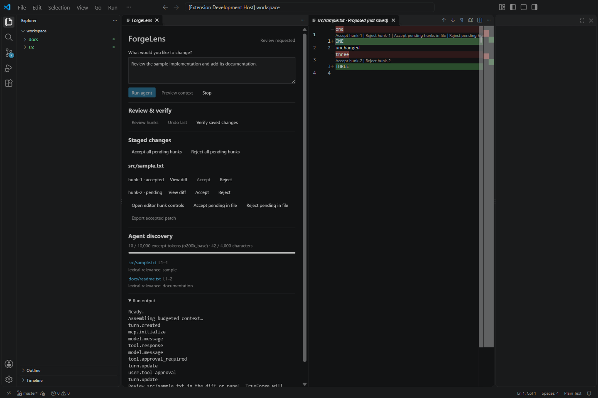
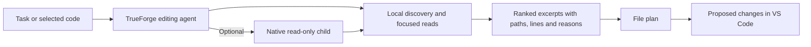
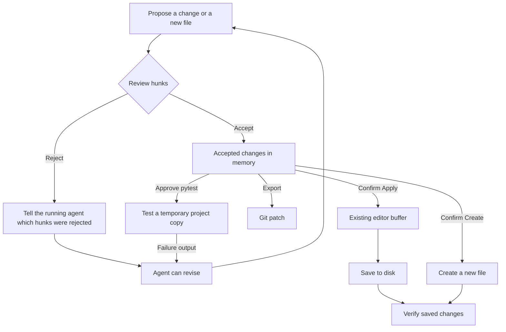

# ForgeLens

ForgeLens is a desktop VS Code extension for making reviewed changes across source, tests and documentation. Describe the outcome in the agent panel or select a function to edit inline. TrueForge runs the model and tool loop. Each proposed change opens for review in your editor.

[Install ForgeLens 0.3.0](https://github.com/aceholland/forgelens/releases/download/v0.3.0/forgelens-0.3.0.vsix) · [Watch live review and undo, 1m 06s](https://github.com/aceholland/forgelens/releases/download/v0.3.0/ForgeLens-0.3.0-review.mp4) · [Original narrated Round 1 demo, 3m 59s](https://drive.google.com/file/d/1XiT8MMKxJyZTAejPxJvrqI8tOzk0gSjs/view) · [Round 1 PDF](docs/technical-writeup.pdf)

Version 0.3.0 is a post-deadline release. Read the [two-page evidence supplement](https://github.com/aceholland/forgelens/releases/download/v0.3.0/ForgeLens-0.3.0-evidence.pdf) or [plain-text overview](https://github.com/aceholland/forgelens/releases/download/v0.3.0/ForgeLens-0.3.0-overview.txt). The original competition recording, write-up and installable extension are preserved with [Round 1 release 0.1.13](https://github.com/aceholland/forgelens/releases/tag/v0.1.13).



## Task B and feature evidence

| Question | Observed result |
| --- | --- |
| Did a real model produce a working Flask command? | Gemini Flash Lite produced a four-file patch from the unchanged, path-free Task B prompt in 170 seconds in a headless TrueForge run. One procedural clarification supplied no code or paths. Replaying that exact patch passed **59 CLI tests and all 491 Flask tests**. The grader also checked help, JSON, 16 sensitive keys, ordinary values, docs and the newly added test. [Watch the independent check in VS Code, 1m 20s](https://github.com/aceholland/forgelens/releases/download/v0.3.0/ForgeLens-0.3.0-task-b-replay.mp4) · [Run and patch](docs/evidence/task-b-flash-lite/README.md) |
| Can I verify those four files before applying them? | The staged validator passed the same **59 CLI and 491 full-suite tests** with Flask’s public test fixture explicitly pinned. All 235 tracked files kept their original hashes. The default copy excludes dotenv files. [Staged replay and fixture setup](docs/evidence/task-b-flash-lite/staged-replay.md) |
| Does live feedback change what the agent sees? | In real Windows VS Code, a scripted model received the exact accepted and rejected hunks, then read the accepted overlay. In a second fixture it received an actual pytest failure and repaired the change in the same turn. The original three file hashes stayed unchanged. [Review and repair evidence](docs/live-review-check.md) |
| Does allocating context across more files help? | On an independently selected set of 40 Flask changes, every target file appeared in the context for **16/40** changes versus **3/40** with whole-file BM25. ForgeLens used 5,016 excerpt tokens on average. The report includes the queries, both methods, scores and the separate published 79-change sample. [Retrieval evaluation](docs/flask-retrieval.md) |

## What you can do

[See how these controls map to the reference demo](docs/video-comparison.md).

| In the editor | What happens |
| --- | --- |
| **Preview context** | See which paths, line ranges and selection reasons would reach the agent. Local ranking combines text relevance (BM25), file roles, symbols and static imports. Two limits bound the excerpts, initially 24,000 characters and 10,000 reference tokens. Preview works offline. |
| **Run agent** | Give a multi-file request without naming paths. The editor shows discovery, the file plan, tool activity, review requests and the run result. An optional native TrueForge child can investigate supporting code inside the same turn. |
| **Draft from context** | Ask for a specific change across existing files. ForgeLens selects excerpts locally and gives the model one editor tool to propose the edits together. Review each hunk and approve any requested pytest run. Choose **Run agent** when the task needs other files, more investigation or a clarification. |
| **Edit selection** | Select code and press **Ctrl+Alt+I** or **Cmd+Alt+I**. The editor checks the proposed changes stay inside the selection. |
| **Review a proposal** | Accept or reject an individual hunk, the pending hunks in a file, or all pending hunks. Use the panel or open the editor hunk controls. The running agent receives the decisions and can read the accepted version. |
| **Test before applying** | Approve a pytest request to run against a temporary copy containing the staged candidate. A failure and its output go back to the agent so it can revise the proposal in the same turn. |
| **Apply, export or undo** | Export the accepted hunks as a Git patch, or confirm Apply. Existing-file edits go into an unsaved buffer. New files require a separate creation confirmation. Undo checks for intervening changes. |
| **Verify saved changes** | Choose Git status, Git diff checks, or Flask CLI tests from the native picker. The task terminal shows the output. The panel reports exit status and duration. |
| **Stop or recover** | Escape in the panel stops the run and clears pending proposals. The panel reports cancellation time. For qualifying early failures, the runner retries after 0.8 and 1.6 seconds or waits longer when the provider specifies a retry interval. A configured fallback can then take over. Once an edit may have been staged, the runner avoids automatic replay. |

<details>
<summary>Earlier context-preview walkthrough</summary>

In 0.2.0, the local preview identified Flask's CLI code, tests and documentation from the original path-free request. A separate Qwen3 1.7B trial found the same three files and timed out before proposing a change. [Narrated 0.2.0 preview](https://github.com/aceholland/forgelens/releases/download/v0.2.0/ForgeLens-0.2.0-preview.mp4) · [Original screenshot](docs/preview-context-flask.png)

</details>

## Try it in VS Code

**1. Install v0.3.0.** Download the VSIX at the top of this page. In desktop VS Code, open the Command Palette, choose **Extensions: Install from VSIX…** and select the downloaded file. Open a local project folder you trust.

**2. Start TrueForge.** Install Node.js 22.14 or newer and npm on the machine running the extension. The commands below start the version used in the demo. The loopback exception lets TrueForge reach ForgeLens’s local editor tools.

**Windows PowerShell**

```powershell
$env:HOST = '127.0.0.1'
$env:NETWORK_POLICY_ENABLED = 'true'
$env:OUTBOUND_URL_ALLOWED_HOSTS = '["127.0.0.1"]'
$env:MODEL_HTTP_MAX_RETRIES = '5'
npx.cmd @truefoundry/trueforge@0.185.1 --port 8790
```

**macOS or Linux shell**

```sh
HOST=127.0.0.1 NETWORK_POLICY_ENABLED=true OUTBOUND_URL_ALLOWED_HOSTS='["127.0.0.1"]' \
  MODEL_HTTP_MAX_RETRIES=5 npx @truefoundry/trueforge@0.185.1 --port 8790
```

**3. Choose a model.** Open [local TrueForge](http://127.0.0.1:8790), add your provider in **Settings → Models**, and copy its model ID. Set `forgelens.model` to that ID in VS Code User Settings. Provider keys belong in TrueForge. If you have a second model, set `forgelens.fallbackModel` to its ID. An existing TrueForge server listening on IPv6 loopback needs `forgelens.baseUrl` set to `http://[::1]:8790`. [Example model configuration](agent/model.example.json)

**4. Make a first edit.** Select a function and press **Ctrl+Alt+I** (**Cmd+Alt+I** on macOS), or run **ForgeLens: Edit Selection**. For a multi-file task, run **ForgeLens: Open Agent**, describe the outcome and choose **Run agent**. ForgeLens registers its local editor tools and supplies the agent definition when it creates the TrueForge session. The panel shows the files it chose and streams progress. Accept or reject hunks as they arrive. When the agent finishes, choose **Review hunks** to apply the accepted result. Save the editor buffer and run the project tests. [Agent definition](agent/forgelens.json) · [Session setup](src/client.ts)

## How discovery works



Use `@file:src/example.py` or `@symbol:get_debug_flag` to steer discovery. The token meter counts source excerpts using `o200k_base`. The provider may use a different tokenizer and also receives instructions, tool definitions and responses. Git ignore rules apply to automatic discovery. Put one literal file or folder path per line in a root `.forgelensignore` to exclude it even from explicit tool requests.

Enable **ForgeLens › Context Scout** to let TrueForge create a child during multi-file requests. The child can read and search saved source. A parent-connector call from a child is denied before it reaches the editor. Scouting uses additional model calls and is off by default. [Native runtime regression check](checks/native-scout.ts) · [Versioned agent definition](agent/forgelens.json)

For a provider with a small request quota, enable **ForgeLens › Compact Requests**. ForgeLens places the locally selected excerpts in the first model request. The model can propose a plan, exact edits across several files and a pytest check in one tool call. ForgeLens verifies all anchors before the first review. The editor still shows each file and asks before executing tests.

For a CPU-hosted model that takes several minutes to generate an edit, set **Run Timeout Minutes** and **Model Call Timeout Seconds** in VS Code User Settings. The defaults are 5 minutes per run and 120 seconds per model call. For slower hardware you can raise the limits to 90 minutes per run and 30 minutes per generation. TrueForge's own provider header and body timeouts must also allow that time. Escape still stops a run. [Reproducible CPU integration setup](checks/run-task-b-runner.sh)

## What happens to proposed changes



The agent can propose a new text file in an existing directory. Inline requests stay within the selected text. Apply and Undo check the current contents before changing anything. Set **ForgeLens › Live Review** off if you prefer to review after the run.

Candidate tests execute trusted project code with your local account's permissions. ForgeLens copies the allowed project files into a temporary directory, applies the accepted overlays there, runs pytest with the configured **Python Path**, returns its exit and output, and removes the copy. If a test depends on a nonsecret, committed dotenv fixture, you can pin its exact Git blob in **User Settings**. The consent dialog lists the pin, and local working-tree dotenv contents stay excluded. [Fixture setup](docs/evidence/task-b-flash-lite/staged-replay.md) · [Candidate validation](src/candidateValidation.ts)

## Round 1 recording

The original Windows recording shows v0.1.13 on [Flask 3.1.3 at the required commit](https://github.com/pallets/flask/tree/22d924701a6ae2e4cd01e9a15bbaf3946094af65). The times below point to the evidence in the narrated recording.

| Task | What happened | Where to look |
| --- | --- | --- |
| **A · Inline edit** | Two reviewed hunks changed how Flask interprets its debug flag. The saved function returned `False` for `off` and `n`, including uppercase variants. Undo and Save restored the baseline. | Diff **0:17** · result **0:36** · Undo **0:40** |
| **B · Multi-file command** | The request named no files. The agent found the CLI, its tests and its documentation. Human review corrected the initial test and docs. A follow-up expanded case-insensitive masking. The final four-file change passed **59 CLI tests**, appeared in help and masked **12** test secrets while leaving an ordinary value visible. | Discovery **0:52** · diff **2:28** · final checks **3:07** · TrueForge session **3:15** |
| **C · Model failure** | An unreachable primary triggered the configured fallback. We rejected one hunk and applied the other to an unsaved buffer, then used Undo and Save. Git was clean and all **235** tracked-file hashes matched the starting state. | Failure and fallback **3:36** · review **3:40** · clean workspace **3:55** |

A separate cancellation at **2:39** preserved the earlier reviewed edits. The recording shows captured command output for verification. [Detailed run evidence](docs/STATUS.md) · [Feature and test register](docs/FEATURES.txt)

## Which VS Code setups were checked?

The extension targets **desktop VS Code 1.101 or newer with a trusted local folder**. The release check builds one VSIX, installs it into isolated Windows, macOS and Linux editor profiles, and verifies its SHA-256. Each editor activates ForgeLens, opens the panel, checks all eight public commands, previews allowed and ignored paths, and runs native Git checks with both a zero and a deliberately nonzero exit. [Installation workflow](.github/workflows/desktop-preview.yml) · [Verified source-build matrix](https://github.com/aceholland/forgelens/actions/runs/45000547014)

| Editor host | Coverage |
| --- | --- |
| Windows x64 stable | Context preview, native picker, recorded live review and staged pytest repair |
| macOS arm64 stable | Context preview and native picker |
| Linux x64 stable and 1.101.0 | Context preview and native picker |

The TrueForge SDK requires a Node extension host. Browser-only VS Code cannot run this build. Full model-driven runs on Remote SSH, WSL, Dev Containers, Codespaces and editor forks remain unverified. [Windows review and repair](docs/live-review-check.md)

## Build from a clean clone

```sh
git clone --branch v0.3.0 https://github.com/aceholland/forgelens.git
cd forgelens
npm ci
python -m pip install pytest==9.0.2
npm run check
npm test
npm run compile
```

Open the cloned folder in desktop VS Code, select **Run ForgeLens** in Run and Debug, and press **F5**. In the Extension Development Host window, open the target project and configure the model as above. To build your own installable VSIX, run `npm run package`. The source test suite includes the optional diagnostic checks. [Windows reproduction guide](WINDOWS_RUNBOOK.md) · [v0.1.13 release and downloads](https://github.com/aceholland/forgelens/releases/tag/v0.1.13)

<details>
<summary>Optional local model helpers</summary>

For a loopback Ollama provider, start with the [model example](agent/model.example.json) and substitute an ID that exists in your TrueForge configuration. To try the optional Groq helper, run `node scripts/groq-demo-gateway.mjs --self-check` for its offline test. Start it without that flag to listen on `http://127.0.0.1:11435/openai/v1`. Point an OpenAI-compatible provider in TrueForge at that address with model ID `openai/gpt-oss-120b` and your own Groq key. A slow incoming upload can exceed the helper’s internal request timer.

For the headless Flask rehearsal, follow the [Windows runbook](WINDOWS_RUNBOOK.md). Set `FORGELENS_PYTHON` to the Python executable if you want syntax validation of proposed Python changes. The rehearsal stages edits for inspection. The desktop recording shows the actual review and save workflow.

</details>

## License and starting point

Team AceSentry built ForgeLens from scratch for the TrueFoundry Forge-a-thon. Anushka Verma leads the team with Ushnish Bagchi and Ayush Paul. [Anushka](https://github.com/aceholland) · [Ushnish](https://github.com/sentry-create) · [Ayush](https://github.com/AyushPaul26)

ForgeLens uses TrueForge for the agent loop and the VS Code API for editor review. [TrueForge](https://github.com/truefoundry/trueforge) · [MIT license](LICENSE) · [Third-party notices](THIRD_PARTY_NOTICES.md)
