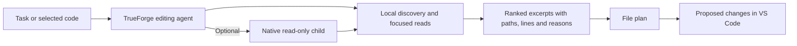
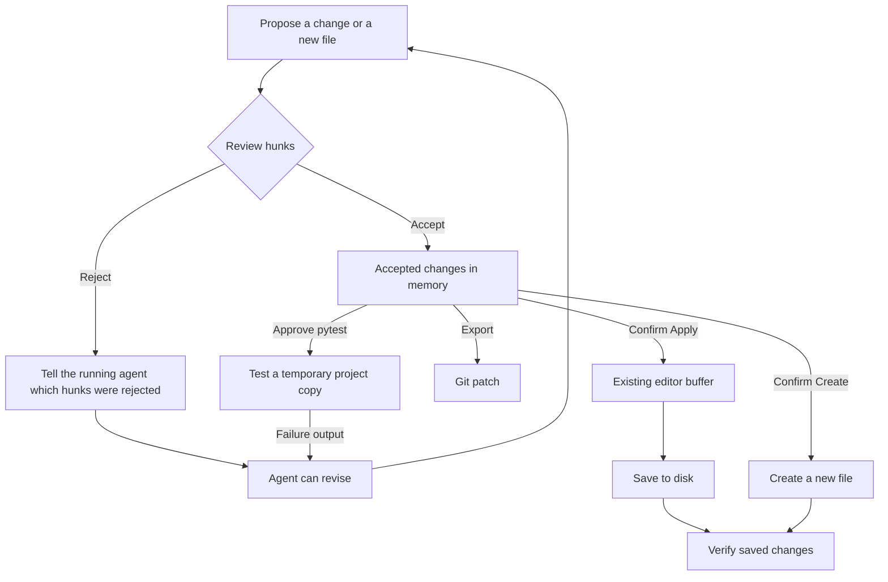

# ForgeLens

ForgeLens is a desktop VS Code extension for making reviewed changes across source, tests and documentation. Describe the outcome in the agent panel or select a function to edit inline. TrueForge runs the model and tool loop. Each proposed change opens for review in your editor.

[Install ForgeLens 0.3.0](https://github.com/aceholland/forgelens/releases/download/v0.3.0/forgelens-0.3.0.vsix) · [Release downloads](https://github.com/aceholland/forgelens/releases/tag/v0.3.0) · [Original narrated Round 1 demo, 3m 59s](https://drive.google.com/file/d/1XiT8MMKxJyZTAejPxJvrqI8tOzk0gSjs/view) · [Round 1 PDF](docs/technical-writeup.pdf)

## What you can do

| In the editor | What happens |
| --- | --- |
| **Preview context** | See which paths, line ranges and selection reasons would reach the agent. Local ranking combines text relevance (BM25), file roles, symbols and static imports. Two limits bound the excerpts, initially 24,000 characters and 10,000 reference tokens. Preview works offline. |
| **Run agent** | Give a multi-file request without naming paths. The editor shows discovery, the file plan, tool activity, review requests and the run result. An optional native TrueForge child can investigate supporting code inside the same turn. |
| **Edit selection** | Select code and press **Ctrl+Alt+I** or **Cmd+Alt+I**. The editor checks the proposed changes stay inside the selection. |
| **Review a proposal** | Accept or reject an individual hunk, the pending hunks in a file, or all pending hunks. Use the panel or open the editor hunk controls. The running agent receives the decisions and can read the accepted version. |
| **Test before applying** | Approve a pytest request to run against a temporary copy containing the staged candidate. A failure and its output go back to the agent so it can revise the proposal in the same turn. |
| **Apply, export or undo** | Export the accepted hunks as a Git patch, or confirm Apply. Existing-file edits go into an unsaved buffer. New files require a separate creation confirmation. Undo checks for intervening changes. |
| **Verify saved changes** | Choose Git status, Git diff checks, or Flask CLI tests from the native picker. The task terminal shows the output. The panel reports exit status and duration. |
| **Stop or recover** | Escape in the panel stops the run and clears pending proposals. The panel reports cancellation time. Two bounded retries precede a configured fallback after qualifying early failures. Once an edit may have been staged, the runner avoids automatic replay. |

## Try it in VS Code

**1. Install the extension.** Download the VSIX above. In desktop VS Code, open the Command Palette, choose **Extensions: Install from VSIX…** and select the downloaded file. Open a local project folder you trust.

**2. Start TrueForge.** Install Node.js 22.14 or newer and npm on the machine running the extension. The commands below start the version used in the demo. The loopback exception lets TrueForge reach ForgeLens’s local editor tools.

**Windows PowerShell**

```powershell
$env:HOST = '127.0.0.1'
$env:NETWORK_POLICY_ENABLED = 'true'
$env:OUTBOUND_URL_ALLOWED_HOSTS = '["127.0.0.1"]'
$env:MODEL_HTTP_MAX_RETRIES = '5'
npx.cmd @truefoundry/trueforge@0.185.1 --port 8790
```

**macOS or Linux shell**

```sh
HOST=127.0.0.1 NETWORK_POLICY_ENABLED=true OUTBOUND_URL_ALLOWED_HOSTS='["127.0.0.1"]' \
  MODEL_HTTP_MAX_RETRIES=5 npx @truefoundry/trueforge@0.185.1 --port 8790
```

**3. Choose a model.** Open [local TrueForge](http://127.0.0.1:8790), add your provider in **Settings → Models**, and copy its model ID. Set `forgelens.model` to that ID in VS Code User Settings. Provider keys belong in TrueForge. If you have a second model, set `forgelens.fallbackModel` to its ID. An existing TrueForge server listening on IPv6 loopback needs `forgelens.baseUrl` set to `http://[::1]:8790`. [Example model configuration](agent/model.example.json)

**4. Make a first edit.** Select a function and press **Ctrl+Alt+I** (**Cmd+Alt+I** on macOS), or run **ForgeLens: Edit Selection**. For a multi-file task, run **ForgeLens: Open Agent**, describe the outcome and choose **Run agent**. The panel shows the files it chose and streams progress. Accept or reject hunks as they arrive. When the agent finishes, choose **Review hunks** to apply the accepted result. Save the editor buffer and run the project tests.

## How discovery works



Use `@file:src/example.py` or `@symbol:get_debug_flag` to steer discovery. The token meter counts source excerpts using `o200k_base`. The provider may use a different tokenizer and also receives instructions, tool definitions and responses. Git ignore rules apply to automatic discovery. Put one literal file or folder path per line in a root `.forgelensignore` to exclude it even from explicit tool requests.

Enable **ForgeLens › Context Scout** to let TrueForge create a child during multi-file requests. The child can read and search saved source. A parent-connector call from a child is denied before it reaches the editor. Scouting uses additional model calls and is off by default. [Native runtime regression check](checks/native-scout.ts) · [Versioned agent definition](agent/forgelens.json)

## What happens to proposed changes



The agent can propose a new text file in an existing directory. Inline requests stay within the selected text. Apply and Undo check the current contents before changing anything. Set **ForgeLens › Live Review** off if you prefer to review after the run.

Candidate tests execute trusted project code with your local account's permissions. ForgeLens copies the allowed project files into a temporary directory, applies the accepted overlays there, runs pytest with the configured **Python Path**, returns its exit and output, and removes the copy. A changed original, a protected path or a conflicting new file stops validation. [Candidate validation](src/candidateValidation.ts) · [Review controls](src/editorReview.ts)

## Round 1 recording

The original Windows recording shows v0.1.13 on [Flask 3.1.3 at the required commit](https://github.com/pallets/flask/tree/22d924701a6ae2e4cd01e9a15bbaf3946094af65). The times below point to the evidence in the narrated recording.

| Task | What happened | Where to look |
| --- | --- | --- |
| **A · Inline edit** | Two reviewed hunks changed how Flask interprets its debug flag. The saved function returned `False` for `off` and `n`, including uppercase variants. Undo and Save restored the baseline. | Diff **0:17** · result **0:36** · Undo **0:40** |
| **B · Multi-file command** | The request named no files. The agent found the CLI, its tests and its documentation. Human review corrected the initial test and docs. A follow-up expanded case-insensitive masking. The final four-file change passed **59 CLI tests**, appeared in help and masked **12** test secrets while leaving an ordinary value visible. | Discovery **0:52** · diff **2:28** · final checks **3:07** · TrueForge session **3:15** |
| **C · Model failure** | An unreachable primary triggered the configured fallback. We rejected one hunk and applied the other to an unsaved buffer, then used Undo and Save. Git was clean and all **235** tracked-file hashes matched the starting state. | Failure and fallback **3:36** · review **3:40** · clean workspace **3:55** |

A separate cancellation at **2:39** preserved the earlier reviewed edits. The recording shows captured command output for verification. [Detailed run evidence](docs/STATUS.md) · [Feature and test register](docs/FEATURES.txt)

## Which VS Code setups were checked?

Use **current desktop VS Code with a local folder**. The 0.2.0 preview passed **137 Windows suite tests**, TypeScript checking and compilation. [Four real desktop checks](https://github.com/aceholland/forgelens/actions/runs/44948081092) also activated the extension, registered all eight commands and opened the panel:

| Platform | Actual VS Code | Extension-host Node | Verified workflow |
| --- | --- | --- | --- |
| Windows x64 | Stable 1.147.0 | 24.22.1 | Local context preview and exclusions |
| macOS arm64 | Stable 1.147.0 | 24.22.1 | Local context preview and exclusions |
| Linux x64 | Stable 1.147.0 | 24.22.1 | Local context preview and exclusions |
| Linux x64 | Minimum 1.101.0 | 22.15.1 | Local context preview and exclusions |

All four selected allowed and tracked fixture files, excluded ignored and protected paths even when explicitly mentioned, and left the fixture unchanged. A trap endpoint recorded **zero TrueForge/provider requests**. These checks verify provider-free context preview; they do not establish a full model-driven edit on each platform.

The original Windows v0.1.13 recording follows real model requests through the A/B/C workflow. That release passed **112 extension tests**; a later diagnostic check passed **113**. Its reviewed Flask Task B checkout also passed **59 CLI tests** again on 22 November. Separate [v0.1.13 desktop launch checks](https://github.com/aceholland/forgelens/actions/runs/44943796900) opened the panel on Windows, macOS, Linux, Linux Insiders and Linux 1.96.0. The older 1.96 editor embeds Node 20; the preview requires **VS Code 1.101+** because the TrueForge SDK specifies Node 22 or newer.

Browser-only editors such as `vscode.dev` cannot host this Node extension. Remote SSH, WSL, Dev Containers, Codespaces, Cursor and VSCodium have no verified full run. [Round 1 feature evidence](docs/FEATURES.txt) · [Preview desktop test workflow](.github/workflows/desktop-preview.yml)

## Build from a clean clone

```sh
git clone --branch v0.3.0 https://github.com/aceholland/forgelens.git
cd forgelens
npm ci
python -m pip install pytest==9.0.2
npm run check
npm test
npm run compile
```

Open the cloned folder in desktop VS Code, select **Run ForgeLens** in Run and Debug, and press **F5**. In the Extension Development Host window, open the target project and configure the model as above. To build your own installable VSIX, run `npm run package`. The source test suite includes the optional diagnostic checks. [Windows reproduction guide](WINDOWS_RUNBOOK.md) · [v0.1.13 release and downloads](https://github.com/aceholland/forgelens/releases/tag/v0.1.13)

<details>
<summary>Optional local model helpers</summary>

For a loopback Ollama provider, start with the [model example](agent/model.example.json) and substitute an ID that exists in your TrueForge configuration. To try the optional Groq helper, run `node scripts/groq-demo-gateway.mjs --self-check` for its offline test. Start it without that flag to listen on `http://127.0.0.1:11435/openai/v1`. Point an OpenAI-compatible provider in TrueForge at that address with model ID `openai/gpt-oss-120b` and your own Groq key. A slow incoming upload can exceed the helper’s internal request timer.

For the headless Flask rehearsal, follow the [Windows runbook](WINDOWS_RUNBOOK.md). Set `FORGELENS_PYTHON` to the Python executable if you want syntax validation of proposed Python changes. The rehearsal stages edits for inspection. The desktop recording shows the actual review and save workflow.

</details>

## License and starting point

Team AceSentry built ForgeLens from scratch for the TrueFoundry Forge-a-thon. There is no upstream editor fork. The extension uses [TrueForge](https://github.com/truefoundry/trueforge) for its agent loop and the VS Code API for editor review. See the [MIT license](LICENSE) and [third-party notices](THIRD_PARTY_NOTICES.md).
