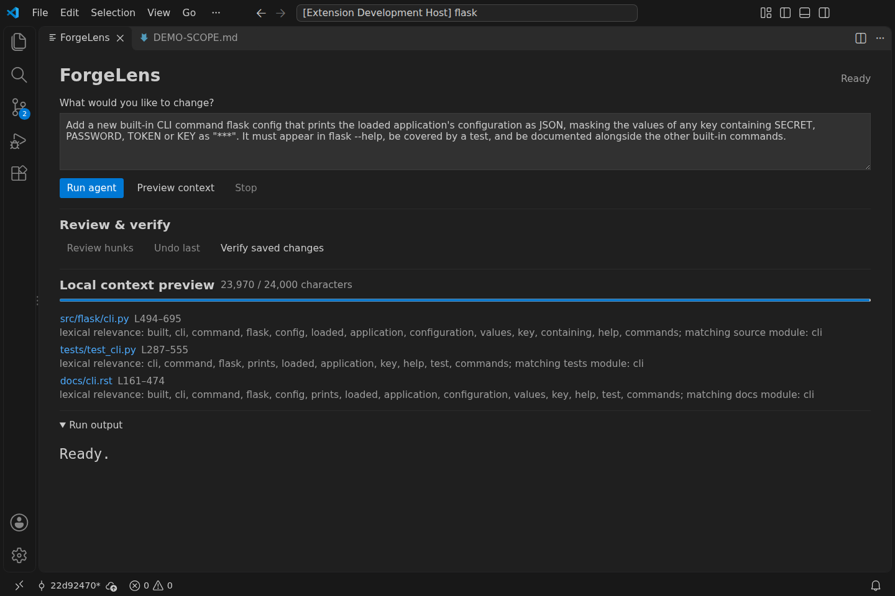
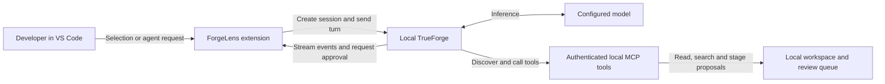
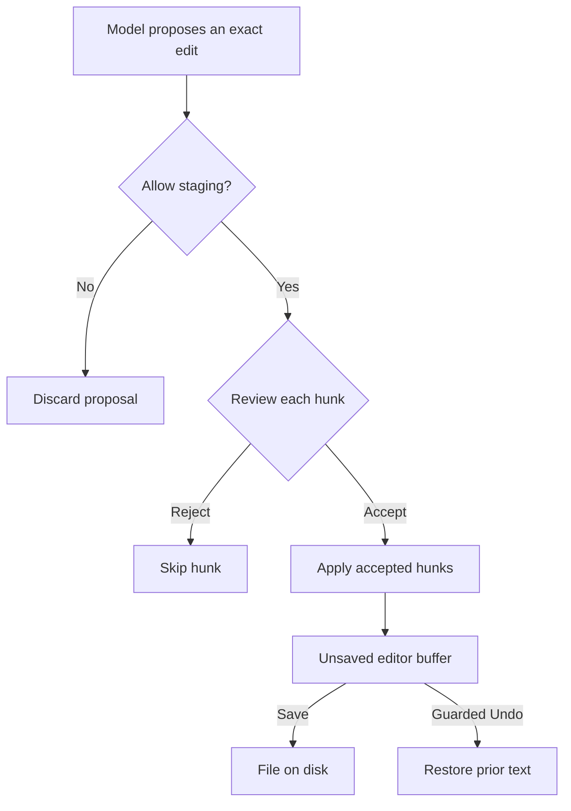

# ForgeLens

ForgeLens is a VS Code extension for reviewing AI-assisted changes in a local repository. Select a function to request a focused edit, or ask the agent panel for a change that spans source code, tests and documentation. TrueForge runs the agent. You choose which hunks to apply and when to save them.

[Watch the narrated demo (3:59)](https://drive.google.com/file/d/1XiT8MMKxJyZTAejPxJvrqI8tOzk0gSjs/view) · [Read the three-page write-up](docs/technical-writeup.pdf) · [Download the v0.1.13 extension](https://github.com/aceholland/forgelens/releases/download/v0.1.13/forgelens-0.1.13.vsix)

### Try the 22 November preview

ForgeLens 0.2.0 adds a local context preview. You can see which files an agent would receive, why they were selected and which lines are included before using any model quota. Open a path to inspect its excerpt, or exclude a private directory with `.forgelensignore`.



The Task B request names no files. On Linux, the panel found all three using **23,970 of 24,000 excerpt characters**.

In a separate free local-model trial, Qwen3 1.7B called the ForgeLens tools five times and identified the same implementation, test and documentation files without hints. It reached its time limit before proposing an edit. The completed four-file Task B result and its 59 passing CLI tests are in the original Round 1 video.

The preview also lets you decide hunks in any order, export the accepted changes as a Git patch, and run Git or Flask checks in the VS Code terminal. An optional read-only TrueForge scout can gather context before a multi-file edit. The recorded Round 1 demo above uses v0.1.13.

All 137 extension tests passed on Windows. In four real desktop editor configurations, the context preview made zero model requests. Each editor ran the Git checks successfully and reported the expected failure for a deliberately introduced whitespace error. [Windows, macOS and Linux test results](https://github.com/aceholland/forgelens/actions/runs/44949168156)

[Install v0.2.0](https://github.com/aceholland/forgelens/releases/download/v0.2.0/forgelens-0.2.0.vsix) · [Watch the narrated preview](https://github.com/aceholland/forgelens/releases/download/v0.2.0/ForgeLens-0.2.0-preview.mp4) · [Preview source, setup and diagrams](https://github.com/aceholland/forgelens/tree/v0.2.0#readme) · [Download the plain-text overview](https://github.com/aceholland/forgelens/releases/download/v0.2.0/ForgeLens-0.2.0-overview.txt)

## Reproduce the Round 1 build in VS Code

**1. Install v0.1.13.** Download the recorded extension at the top of this page. In desktop VS Code, open the Command Palette, choose **Extensions: Install from VSIX…** and select the downloaded file. Open a local project folder you trust.

**2. Start TrueForge.** Install Node.js 22.14 or newer and npm on the machine running the extension. The commands below start the version used in the demo. The loopback exception lets TrueForge reach ForgeLens’s local editor tools.

**Windows PowerShell**

```powershell
$env:HOST = '127.0.0.1'
$env:NETWORK_POLICY_ENABLED = 'true'
$env:OUTBOUND_URL_ALLOWED_HOSTS = '["127.0.0.1"]'
$env:MODEL_HTTP_MAX_RETRIES = '5'
npx.cmd @truefoundry/trueforge@0.185.1 --port 8790
```

**macOS or Linux shell**

```sh
HOST=127.0.0.1 NETWORK_POLICY_ENABLED=true OUTBOUND_URL_ALLOWED_HOSTS='["127.0.0.1"]' \
  MODEL_HTTP_MAX_RETRIES=5 npx @truefoundry/trueforge@0.185.1 --port 8790
```

**3. Choose a model.** Open [local TrueForge](http://127.0.0.1:8790), add your provider in **Settings → Models**, and copy its model ID. Set `forgelens.model` to that ID in VS Code User Settings. Provider keys belong in TrueForge. If you have a second model, set `forgelens.fallbackModel` to its ID. An existing TrueForge server listening on IPv6 loopback needs `forgelens.baseUrl` set to `http://[::1]:8790`. [Example model configuration](agent/model.example.json)

**4. Make a first edit.** Select a function and press **Ctrl+Alt+I** (**Cmd+Alt+I** on macOS), or run **ForgeLens: Edit Selection**. For a multi-file task, run **ForgeLens: Open Agent**, describe the outcome and choose **Run agent**. The panel shows the files it chose and streams progress. After the run, choose **Review hunks**. Apply the hunks you accept, save, then run your tests.

## How a request reaches the editor



TrueForge decides which tools to call. ForgeLens ranks paths and symbols, selects short excerpts, and displays the file, line range and reason for each choice. You can steer retrieval with `@file:src/example.py` or `@symbol:get_debug_flag`. The default excerpt budget is **24,000 characters**. Tool metadata, later reads and model output consume additional context.

The extension uses the official TrueForge SDK. At session creation it fills in the selected model and temporary MCP connector, then sends the agent specification to TrueForge. Tools load on demand by default. Set `forgelens.preloadTools` for a model that needs their schemas up front. [Versioned agent definition](agent/forgelens.json)

## What Accept, Apply and Save do



ForgeLens checks that the expected text still matches before it applies or undoes a change. It preserves line endings and keeps inline edits within the selected scope. **Stop** cancels the active run and discards pending proposals. To reverse an applied edit, use **ForgeLens: Undo Last Accepted Change**, then save the restored text. Validation commands require a separate approval and read saved files.

## The three Flask tasks

The demo uses [Flask 3.1.3 at the required commit](https://github.com/pallets/flask/tree/22d924701a6ae2e4cd01e9a15bbaf3946094af65). The times below point to the evidence in the narrated recording.

| Task | What happened | Where to look |
| --- | --- | --- |
| **A · Inline edit** | Two reviewed hunks changed how Flask interprets its debug flag. The saved function returned `False` for `off` and `n`, including uppercase variants. Undo and Save restored the baseline. | Diff **0:17** · result **0:36** · Undo **0:40** |
| **B · Multi-file command** | The request named no files. The agent found the CLI, its tests and its documentation. Human review corrected the initial test and docs. A follow-up expanded case-insensitive masking. The final four-file change passed **59 CLI tests**, appeared in help and masked **12** test secrets while leaving an ordinary value visible. | Discovery **0:52** · diff **2:28** · final checks **3:07** · TrueForge session **3:15** |
| **C · Model failure** | An unreachable primary triggered the configured fallback. We rejected one hunk and applied the other to an unsaved buffer, then used Undo and Save. Git was clean and all **235** tracked-file hashes matched the starting state. | Failure and fallback **3:36** · review **3:40** · clean workspace **3:55** |

A separate cancellation at **2:39** preserved the earlier reviewed edits. The recording shows captured command output for verification. [Detailed run evidence](docs/STATUS.md) · [Feature and test register](docs/FEATURES.txt)

## Additional features and limits

| Feature | Behavior and verification |
| --- | --- |
| **Model fallback and deadlines** | A second configured model can take over after a confirmed failure with no staged edits. Task C shows the switch. Tests cover model timeouts, ambiguous interruptions and late events. |
| **Focused retrieval and recovery** | Ranked source, test and documentation snippets guide multi-file work. Tests cover explicit mentions, repeat reads and recovery when an edit’s anchor fails. |
| **Workspace protections** | The authenticated loopback bridge filters protected paths, symlinks, binary and oversized files. It limits requests to 2 MiB and 512 input elements. These checks cannot identify every secret embedded in ordinary source. |
| **Command review** | The agent can request approved validation commands, including pytest, Git status or diff, and Flask help. Workspace code can run during a test, so use a trusted folder. |
| **Optional diagnostics** | The Windows rehearsal can parse a proposed Python edit before staging. The optional Groq gateway passed offline forwarding, retry and streaming checks. Live Groq inference remains unverified. |

ForgeLens edits existing files in the first local workspace folder. File creation, deletion and parsing of ignore files are outside the current feature set. Model quality and provider quotas affect whether a request finishes.

## Which VS Code setups were checked?

Use **current desktop VS Code with a local folder** to reproduce the demo. The 20 November Windows recording follows a model request through TrueForge to a reviewed edit. On 22 November 2026 we also checked the published v0.1.13 package in five real VS Code extension hosts. Each loaded the extension, registered all five commands and opened the ForgeLens panel. [Five desktop test results](https://github.com/aceholland/forgelens/actions/runs/44943796900)

| Editor and platform | What we verified |
| --- | --- |
| Windows desktop | Recorded Tasks A, B and C with local TrueForge. Separately installed the release VSIX and checked the panel on Stable 1.147.0 (x64). |
| macOS and Linux desktop | The packaged extension opened its panel on Stable 1.147.0, on Apple silicon and Linux x64. Full model runs were recorded on Windows only. |
| Linux Insiders | The panel and commands worked on 1.148.0-insider. |
| Older VS Code | The panel opened on Linux 1.96.0, the minimum in the manifest. That editor embeds Node 20, while the bundled TrueForge SDK specifies Node 22 or newer. Model execution on 1.96 is unverified. |
| Browser, remote workspaces and forks | Browser-only editors such as `vscode.dev` cannot host this Node extension. Remote SSH, WSL, Dev Containers, Codespaces, Cursor and VSCodium have no verified full run. |

The release checkpoint passed **112 extension tests** on Windows. The current source, which includes an extra Python diagnostic check, passed **113 tests**, TypeScript checking and compilation. The final Flask Task B checkout separately passed **59 CLI tests** again on 22 November. [Feature-by-feature evidence](docs/FEATURES.txt)

## Build from a clean clone

```sh
git clone https://github.com/aceholland/forgelens.git
cd forgelens
npm ci
npm run check
npm test
npm run compile
```

Open the cloned folder in desktop VS Code, select **Run ForgeLens** in Run and Debug, and press **F5**. In the Extension Development Host window, open the target project and configure the model as above. To build your own installable VSIX, run `npm run package`. The source test suite includes the optional diagnostic checks. [Windows reproduction guide](WINDOWS_RUNBOOK.md) · [v0.1.13 release and downloads](https://github.com/aceholland/forgelens/releases/tag/v0.1.13)

<details>
<summary>Optional local model helpers</summary>

For a loopback Ollama provider, start with the [model example](agent/model.example.json) and substitute an ID that exists in your TrueForge configuration. To try the optional Groq helper, run `node scripts/groq-demo-gateway.mjs --self-check` for its offline test. Start it without that flag to listen on `http://127.0.0.1:11435/openai/v1`. Point an OpenAI-compatible provider in TrueForge at that address with model ID `openai/gpt-oss-120b` and your own Groq key. A slow incoming upload can exceed the helper’s internal request timer.

For the headless Flask rehearsal, follow the [Windows runbook](WINDOWS_RUNBOOK.md). Set `FORGELENS_PYTHON` to the Python executable if you want syntax validation of proposed Python changes. The rehearsal stages edits for inspection. The desktop recording shows the actual review and save workflow.

</details>

## License and starting point

Team AceSentry built ForgeLens from scratch for the TrueFoundry Forge-a-thon. There is no upstream editor fork. The extension uses [TrueForge](https://github.com/truefoundry/trueforge) for its agent loop and the VS Code API for editor review. See the [MIT license](LICENSE) and [third-party notices](THIRD_PARTY_NOTICES.md).
