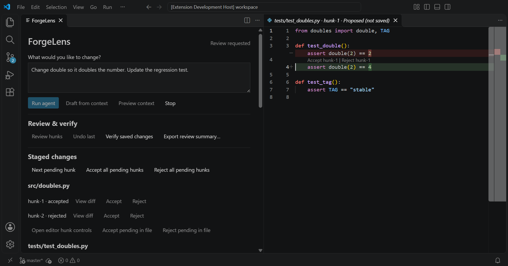
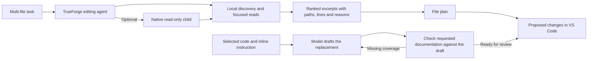
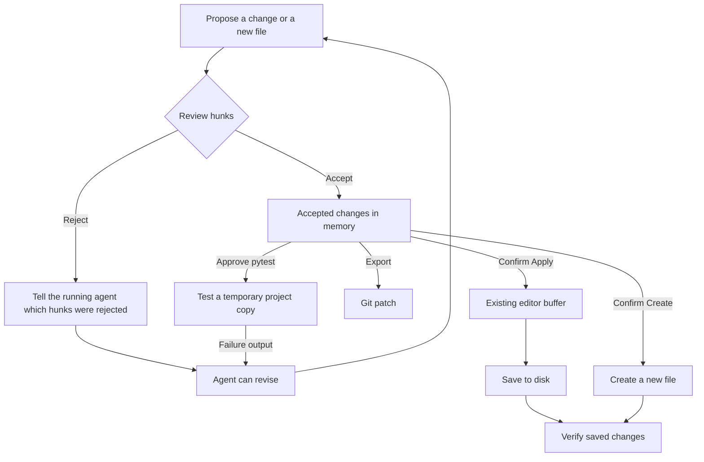

# ForgeLens

ForgeLens is a desktop VS Code extension for making reviewed changes across source, tests and documentation. Describe the outcome in the agent panel or select a function to edit inline. TrueForge runs the model and tool loop. Each proposed change opens for review in your editor.

[Install ForgeLens 0.5.0](https://github.com/aceholland/forgelens/releases/download/v0.5.0/forgelens-0.5.0.vsix) · [Narrated A/B/C demo](https://github.com/aceholland/forgelens/releases/download/v0.5.0/ForgeLens-0.5.0-demo.mp4) · [Video script](docs/video-script.md) · [Illustrated write-up (PDF)](docs/forgelens-0.5.0-illustrated-writeup.pdf) · [Verification files](https://github.com/aceholland/forgelens/releases/tag/v0.5.0)

### Verified on the Windows laptop

**A — inline edit.** Free hosted Nemotron received one instruction. Its first visible diff appeared in 42.6 seconds and correctly documented empty and unset values, all five named false values, and the result for other inputs. The saved change passed 35 helper tests and 490 Flask tests. Undo restored all 235 tracked files.

**B — path-free agent request.** Free hosted ERNIE 5.5 Flash Preview changed the CLI, its tests and documentation from one instruction with zero operator answers. The original TrueForge turn completed in 5 minutes 16 seconds and the provider reported $0. The saved patch passed 64 CLI tests, 496 Flask tests and 16 independent masking cases.

**C — failure recovery.** After an unreachable endpoint and an authentication error, ForgeLens switched to the local model. The editor remained responsive. After Stop all 235 tracked files matched their original hashes.

[Windows screenshots and checks](docs/evidence/v050/README.md) · [Cross-platform CI](https://github.com/aceholland/forgelens/actions/runs/45044139432) · [Download the patches and run receipts](https://github.com/aceholland/forgelens/releases/download/v0.5.0/ForgeLens-0.5.0-evidence.zip)

The daily VS Code profile on this laptop uses free local Qwen on D. In its CPU-only Task B trial, three proposed edits failed validation. ForgeLens stopped after 27 minutes 32 seconds with zero files staged. The filmed A and B runs used separate zero-price hosted models. An earlier local A run passed the behavioral tests but produced a contradictory sentence in its docstring. Earlier hosted B attempts hit rate limits or returned incomplete edits. [CPU-only Task B receipt](docs/evidence/v050/local-task-b.json)

### What’s new in 0.5.0

| When you need to… | Use |
| --- | --- |
| Set up a laptop | **ForgeLens: Check My Setup** checks VS Code, folder trust, Node.js, the TrueForge service and your model registration. Choose **Test model** to send a short connectivity message through TrueForge. |
| Understand a test failure | Run the same tests on separate baseline and candidate copies. The comparison identifies failures introduced by the accepted edits, failures that already existed, and tests that now pass. |
| Check JavaScript or TypeScript changes | Choose **Test accepted changes…** in the review panel. The staged validator supports pytest and the Node.js test runner, including TypeScript supported by your installed Node version. |
| Pick up a review after restart | Enable **Keep reviews on restart** in the panel. Reopen the same workspace and resume the saved review. ForgeLens checks the original files before restoring hunk decisions. |
| Resolve an edit conflict | In the review panel, compare the original, current and proposed text. Edit the merged result, stage it, then review and apply it. Undo restores the pre-apply contents. |

The original Round 1 submission remains available as a [recording](https://drive.google.com/file/d/1XiT8MMKxJyZTAejPxJvrqI8tOzk0gSjs/view) and [PDF](docs/technical-writeup.pdf).

The earlier A/B/C video uses v0.4.0 for the Flask tasks and v0.4.1 for the review navigation and summary export. These releases follow the competition deadline. [Video chapters and results](docs/evidence/v040-abc/README.md) · [Original competition release](https://github.com/aceholland/forgelens/releases/tag/v0.1.13)



## Flask tasks and feature evidence

| Question | Observed result |
| --- | --- |
| Did the first Task A diff cover empty and unset in v0.4.2? | **Yes, in the recorded run.** The free local Qwen3.5-4B model received the official instruction once in Windows VS Code. ForgeLens held one incomplete draft in memory, and Qwen revised it in the same turn. The first visible diff documented an unset variable, an empty string and all five named false values. The operator approved the edit with zero hints or corrections. The saved patch passed 12 input cases, 35 helper tests and all 490 Flask tests. Undo restored all 235 tracked files. [Narrated run](https://github.com/aceholland/forgelens/releases/download/v0.4.2/ForgeLens-0.4.2-task-a.mp4) · [First draft, first diff and earlier attempts](https://github.com/aceholland/forgelens/releases/download/v0.4.2/ForgeLens-0.4.2-task-a.json) · [Exact patch](https://github.com/aceholland/forgelens/releases/download/v0.4.2/ForgeLens-0.4.2-task-a.patch) |
| What happened in Tasks A and C on v0.4.0? | Task A changed the selected function, passed 35 helper tests and restored all 235 tracked files on undo. A follow-up inline review made the empty and unset cases explicit in the docstring. Task C handed off after an unreachable endpoint and an invalid key. The editor stayed responsive, and all 235 file hashes matched after Stop. [Editor sessions, patches and checks](docs/evidence/v040-abc/README.md) |
| Did Task B finish in one go on v0.4.0? | **Yes.** Particle‑1 received the original instruction once in Windows VS Code. In one TrueForge turn it proposed six hunks across the CLI, tests and documentation. The operator approved edits and tests and supplied zero hints or corrections. The saved patch passed **60 CLI tests, all 492 Flask tests and 16 masking cases**. The provider reported **$0**. [Recording and attempt history](docs/evidence/v040-abc/README.md) · [Exact patch](docs/evidence/v040-abc/task-b/candidate.patch) |
| What did the earlier v0.3.1 Task B run verify? | Baidu ERNIE 5.5 Flash Preview received one path-free request in Windows VS Code and proposed changes to three files. With zero operator answers or code corrections, the saved patch passed **59 CLI tests, all 491 Flask tests and 16 independent masking cases**. [v0.3.1 video](https://github.com/aceholland/forgelens/releases/download/v0.3.1/ForgeLens-task-b-one-go.mp4) · [Session, patch and checks](docs/evidence/task-b-editor-one-go/README.md) |
| Can I test accepted changes before applying? | In an earlier four-file Flash Lite replay, the staged validator passed **59 CLI and 491 full-suite tests** with Flask’s public test fixture explicitly pinned. All 235 tracked files kept their original hashes. The default copy excludes dotenv files. [Staged replay and fixture setup](docs/evidence/task-b-flash-lite/staged-replay.md) |
| Does live feedback change what the agent sees? | In real Windows VS Code, a scripted model received the exact accepted and rejected hunks, then read the accepted overlay. In a second fixture it received an actual pytest failure and repaired the change in the same turn. The original three file hashes stayed unchanged. [Review and repair evidence](docs/live-review-check.md) |
| Does allocating context across more files help? | On an independently selected set of 40 Flask changes, every target file appeared in the context for **16/40** changes versus **3/40** with whole-file BM25. ForgeLens used 5,016 excerpt tokens on average. The report includes the queries, both methods, scores and the separate published 79-change sample. [Retrieval evaluation](docs/flask-retrieval.md) |

The v0.3.1 Windows run took **4 minutes 18 seconds**. The provider reported **$0** for its two responses. Other free configurations timed out, hit quotas or produced an incomplete change. [Earlier attempts](docs/evidence/task-b-windows-one-go/attempts.md) · [Reproduce the v0.3.1 settings](docs/repeat-task-b.md#recorded-configuration)

## What you can do

[See how these controls map to the reference demo](docs/video-comparison.md).

### Five additions in v0.4.2

| Tool | How to use it |
| --- | --- |
| **Filter review hunks** | In **Staged changes**, search by file path and choose a decision status to narrow the visible queue. |
| **Check workspace conflicts** | Check accepted files against their reviewed originals before applying. The panel identifies changed buffers and collisions with newly created paths. |
| **Export a single file’s accepted patch** | Use the file’s export control to save its accepted hunks as a standalone Git patch. |
| **Compare Context Budgets** | Run this command from the Command Palette. Enter a task and an alternative token limit. The read-only report shows which files and excerpt ranges each budget selects from the same saved workspace snapshot. |
| **Find Related Tests** | With a source file active, run this Command Palette command. Choose a test to open. The picker explains whether it imports the source or has a matching filename. Static import matching covers Python and JavaScript/TypeScript. |

Both context commands run locally and respect ForgeLens’s file exclusions. All five tools ran in native Windows VS Code 1.95.0 and 1.147.0 with the released installer. [Windows screenshots and receipts](https://github.com/aceholland/forgelens/releases/download/v0.4.2/ForgeLens-0.4.2-task-a-evidence.zip) · [v0.4.2 cross-platform desktop checks](https://github.com/aceholland/forgelens/releases/download/v0.4.2/ForgeLens-0.4.2-package-verification.json)

<details>
<summary>See the five tools in Windows VS Code</summary>

| Review a change | Explore a workspace |
| --- | --- |
| [Filter by file and decision](https://github.com/aceholland/forgelens/releases/download/v0.4.2/ForgeLens-0.4.2-filtered-hunks.png) | [Compare excerpt ranges at two budgets](https://github.com/aceholland/forgelens/releases/download/v0.4.2/ForgeLens-0.4.2-context-budgets.png) |
| [Inspect a conflict with an unsaved buffer](https://github.com/aceholland/forgelens/releases/download/v0.4.2/ForgeLens-0.4.2-workspace-conflict.png) | [Open a related test from the native picker](https://github.com/aceholland/forgelens/releases/download/v0.4.2/ForgeLens-0.4.2-related-tests.png) |
| [Inspect a single file’s exported patch](https://github.com/aceholland/forgelens/releases/download/v0.4.2/ForgeLens-0.4.2-one-file-patch.png) | |

</details>

### Agent and review controls

| In the editor | What happens |
| --- | --- |
| **Preview context** | See which paths, line ranges and selection reasons would reach the agent. Local ranking combines text relevance (BM25), file roles, symbols and static imports. Two limits bound the excerpts, initially 24,000 characters and 10,000 reference tokens. Preview works offline. |
| **Run agent** | Give a multi-file request without naming paths. The editor shows discovery, the file plan, tool activity, review requests and the result. Turn off **ForgeLens › Ask Questions** to run from the original request and repository context. Review and test approvals still appear. An optional native TrueForge child can investigate supporting code in the same turn. |
| **Draft from context** | ForgeLens selects excerpts and gives the model their line numbers. It can replace an exact match or insert at a line it saw. For small models, turn on **Sequential Draft** to review one planned file at a time and test the assembled changes. Choose **Run agent** when the task needs broader discovery. |
| **Edit selection** | Select code and press **Ctrl+Alt+I** or **Cmd+Alt+I**. The editor checks the proposed changes stay inside the selection. |
| **Review a proposal** | Accept or reject an individual hunk, the pending hunks in a file, or all pending hunks. Use the panel or open the editor hunk controls. The running agent receives the decisions and can read the accepted version. |
| **Find the next pending hunk** | Choose **Next pending hunk** to open the next undecided change in the editor. Repeated clicks cycle across the available hunks without changing a decision. |
| **Export a review summary** | Choose **Export review summary…** to save JSON with the latest accepted, rejected and pending counts for each file. The report records the most recent staged pytest exit code, its completion time and whether subsequent review activity occurred. It contains relative file names and counts. It stays available after Apply until the next run or workspace change. |
| **Test before applying** | If an accepted draft changes a Python test, ForgeLens offers to run that test file. The model can also request tests. Approving the run executes pytest on a temporary copy. The exit status and output return to the model so it can repair a failing change in the same turn. |
| **Apply, export or undo** | Export the accepted hunks as a Git patch, or confirm Apply. Existing-file edits go into an unsaved buffer. New files require a separate creation confirmation. Undo checks for intervening changes. |
| **Verify saved changes** | Choose Git status, Git diff checks, or Flask CLI tests from the native picker. The task terminal shows the output. The panel reports exit status and duration. |
| **Stop or recover** | Escape in the panel stops the run and clears pending proposals. The panel reports cancellation time. For qualifying early failures, the runner retries after 0.8 and 1.6 seconds or waits longer when the provider specifies a retry interval. A configured fallback can then take over. Once an edit may have been staged, the runner avoids automatic replay. |

<details>
<summary>Earlier context-preview walkthrough</summary>

In 0.2.0, the local preview identified Flask's CLI code, tests and documentation from the original path-free request. A separate Qwen3 1.7B trial found the same three files and timed out before proposing a change. [Narrated 0.2.0 preview](https://github.com/aceholland/forgelens/releases/download/v0.2.0/ForgeLens-0.2.0-preview.mp4) · [Original screenshot](docs/preview-context-flask.png)

</details>

## Try it in VS Code

**1. Install v0.5.0.** Download the VSIX at the top of this page. In desktop VS Code, open the Command Palette, choose **Extensions: Install from VSIX…** and select the downloaded file. Open a local project folder you trust.

**2. Start TrueForge.** Install Node.js 22.14 or newer and npm on the machine running the extension. The commands below start the version used in the demo. The loopback exception lets TrueForge reach ForgeLens’s local editor tools.

**Windows PowerShell**

```powershell
$env:HOST = '127.0.0.1'
$env:NETWORK_POLICY_ENABLED = 'true'
$env:OUTBOUND_URL_ALLOWED_HOSTS = '["127.0.0.1"]'
$env:MODEL_HTTP_MAX_RETRIES = '5'
npx.cmd @truefoundry/trueforge@0.185.1 --port 8790
```

**macOS or Linux shell**

```sh
HOST=127.0.0.1 NETWORK_POLICY_ENABLED=true OUTBOUND_URL_ALLOWED_HOSTS='["127.0.0.1"]' \
  MODEL_HTTP_MAX_RETRIES=5 npx @truefoundry/trueforge@0.185.1 --port 8790
```

**3. Choose a model.** To keep source on your machine and avoid per-request inference charges, run a coding model in llama.cpp and connect it to local TrueForge. Model size, available memory and CPU speed affect wait times. For a public project you can also use Kilo’s free anonymous gateway, which receives the task and selected source excerpts and enforces a shared request limit. [Local model setup](docs/llama-draft-provider.md) · [Free gateway setup](docs/anonymous-model.md)

To use your own provider, open local TrueForge, add it in **Settings → Models**, and copy its model ID into `forgelens.model` in VS Code User Settings. Provider keys belong in TrueForge. For an IPv6 loopback server, set `forgelens.baseUrl` to `http://[::1]:8790`. [Local TrueForge](http://127.0.0.1:8790) · [Example model configuration](agent/model.example.json)

**Set a fallback order.** Put additional TrueForge model IDs in `forgelens.fallbackModels`, in the order you want them tried. Use IDs from your own catalog. For a free-only setup, choose free or local models for every entry. After an eligible failure, the panel shows which model ForgeLens is trying next. Once the agent has acted on a request, safeguards prevent replaying edits. Existing users can keep their single `forgelens.fallbackModel` setting when the list is empty.

```json
{
  "forgelens.model": "my-provider/primary",
  "forgelens.fallbackModels": ["my-provider/backup", "local-ollama/qwen-local"]
}
```

**4. Check your setup.** Run **ForgeLens: Check My Setup** from the Command Palette. The Setup output identifies the first missing prerequisite. When the catalog and model are ready, select **Test model** for an end-to-end check.

**5. Make a first edit.** Select a function and press **Ctrl+Alt+I** (**Cmd+Alt+I** on macOS), or run **ForgeLens: Edit Selection**. For a multi-file task, run **ForgeLens: Open Agent**, describe the outcome and choose **Run agent**. ForgeLens registers its local editor tools and supplies the agent definition when it creates the TrueForge session. The panel shows the files it chose and streams progress. Accept or reject hunks as they arrive. When the agent finishes, choose **Review hunks** to apply the accepted result. Save the editor buffer and run the project tests. [Agent definition](agent/forgelens.json) · [Session setup](src/client.ts)

## How discovery works



Use `@file:src/example.py` or `@symbol:get_debug_flag` to steer discovery. The token meter counts source excerpts using `o200k_base`. The provider may use a different tokenizer and also receives instructions, tool definitions and responses. Git ignore rules apply to automatic discovery. Put one literal file or folder path per line in a root `.forgelensignore` to exclude it even from explicit tool requests.

Enable **ForgeLens › Context Scout** to let TrueForge create a child during multi-file requests. The child can read and search saved source. A parent-connector call from a child is denied before it reaches the editor. Scouting uses additional model calls and is off by default. [Native runtime regression check](checks/native-scout.ts) · [Versioned agent definition](agent/forgelens.json)

For a provider with a small request quota, enable **ForgeLens › Compact Requests**. ForgeLens places the locally selected excerpts in the first model request. The model can propose a plan, exact edits across several files and a pytest check in one tool call. ForgeLens verifies all anchors before the first review. The editor still shows each file and asks before executing tests.

**Long conversations.** TrueForge automatically summarizes earlier messages and continues the turn when input reaches 60,000 tokens. For a model with a known smaller context window, ForgeLens triggers compaction at 80% of that window when this gives a lower threshold. The threshold follows the active model if fallback occurs. The source preview's token budget controls how much code is retrieved for an individual request. [Agent definition](agent/forgelens.json) · [Native compaction check](checks/native-scout.ts)

For a CPU-hosted model that takes several minutes to generate an edit, set **Run Timeout Minutes** and **Model Call Timeout Seconds** in VS Code User Settings. The defaults are 5 minutes per run and 120 seconds per model call. For slower hardware you can raise the limits to 90 minutes per run and 30 minutes per generation. TrueForge's own provider header and body timeouts must also allow that time. Escape still stops a run. [Reproducible CPU integration setup](checks/run-task-b-runner.sh)

If a local llama.cpp model answers a draft in prose, you can opt into a loopback adapter that requests a native edit proposal on the first generation. The model supplies every file path and edit. VS Code still asks for hunk and test approval. [Local provider setup](docs/llama-draft-provider.md)

## What happens to proposed changes



The agent can propose a new text file in an existing directory. Inline requests stay within the selected text. Apply and Undo check the current contents before changing anything. Set **ForgeLens › Live Review** off if you prefer to review after the run.

Candidate tests execute trusted project code with your local account's permissions. ForgeLens copies the allowed project files into a temporary directory, applies the accepted overlays there, runs pytest with the configured **Python Path**, returns its exit and output, and removes the copy. If a test depends on a nonsecret, committed dotenv fixture, you can pin its exact Git blob in **User Settings**. The consent dialog lists the pin, and local working-tree dotenv contents stay excluded. [Fixture setup](docs/evidence/task-b-flash-lite/staged-replay.md) · [Candidate validation](src/candidateValidation.ts)

## Round 1 recording

The original Windows recording shows v0.1.13 on [Flask 3.1.3 at the required commit](https://github.com/pallets/flask/tree/22d924701a6ae2e4cd01e9a15bbaf3946094af65). The times below point to the evidence in the narrated recording.

| Task | What happened | Where to look |
| --- | --- | --- |
| **A · Inline edit** | Two reviewed hunks changed how Flask interprets its debug flag. The saved function returned `False` for `off` and `n`, including uppercase variants. Undo and Save restored the baseline. | Diff **0:17** · result **0:36** · Undo **0:40** |
| **B · Multi-file command** | The request named no files. The agent found the CLI, its tests and its documentation. Human review corrected the initial test and docs. A follow-up expanded case-insensitive masking. The final four-file change passed **59 CLI tests**, appeared in help and masked **12** test secrets while leaving an ordinary value visible. | Discovery **0:52** · diff **2:28** · final checks **3:07** · TrueForge session **3:15** |
| **C · Model failure** | An unreachable primary triggered the configured fallback. We rejected one hunk and applied the other to an unsaved buffer, then used Undo and Save. Git was clean and all **235** tracked-file hashes matched the starting state. | Failure and fallback **3:36** · review **3:40** · clean workspace **3:55** |

A separate cancellation at **2:39** preserved the earlier reviewed edits. The recording shows captured command output for verification. [Detailed run evidence](docs/STATUS.md) · [Feature and test register](docs/FEATURES.txt)

## Which VS Code setups were checked?

The extension targets **desktop VS Code 1.95 or newer with a trusted local folder**. TrueForge runs in a separate Node.js 22.14+ process. The release check installs one VSIX into isolated Windows, macOS and Linux editor profiles. Each editor checks the public commands, previews allowed and ignored paths, compares excerpt budgets, opens a related test, and runs Git checks with both a zero and a deliberately nonzero exit. The live review check uses a real local TrueForge server and a scripted provider. Two models reject the request. The third receives the hunk decisions and the result of running pytest in the staged copy. The check also verifies that the original files keep their hashes. [Installation workflow](.github/workflows/desktop-preview.yml) · [Tested installer and platform results](https://github.com/aceholland/forgelens/releases/download/v0.5.0/ForgeLens-0.5.0-package-verification.json)

| Editor host | Coverage |
| --- | --- |
| Windows x64 stable | Context preview, native picker, recorded live review and staged pytest repair |
| macOS arm64 stable | Context preview, native picker, live hunk decisions, staged pytest and model feedback |
| Linux x64 stable | Context preview, native picker, live hunk decisions, staged pytest and model feedback |
| Linux x64 1.101.0 | Installation, activation, context preview and native picker |
| Linux x64 1.95.0 | Installation, activation, context preview, native picker, ordered fallback, hunk review and staged pytest |

The TrueForge SDK requires a Node extension host. Browser-only VS Code cannot run this build. Full model-driven runs on Remote SSH, WSL, Dev Containers, Codespaces and editor forks remain unverified. [Windows review and repair](docs/live-review-check.md)

## Build from a clean clone

```sh
git clone --branch v0.5.0 https://github.com/aceholland/forgelens.git
cd forgelens
npm ci
python -m pip install pytest==9.0.2
npm run check
npm test
npm run compile
```

Open the cloned folder in desktop VS Code, select **Run ForgeLens** in Run and Debug, and press **F5**. In the Extension Development Host window, open the target project and configure the model as above. To build your own installable VSIX, run `npm run package`. The source test suite includes the optional diagnostic checks. [Windows reproduction guide](WINDOWS_RUNBOOK.md) · [v0.1.13 release and downloads](https://github.com/aceholland/forgelens/releases/tag/v0.1.13)

<details>
<summary>Optional local model helpers</summary>

For a loopback Ollama provider, start with the [model example](agent/model.example.json) and substitute an ID that exists in your TrueForge configuration. To try the optional Groq helper, run `node scripts/groq-demo-gateway.mjs --self-check` for its offline test. Start it without that flag to listen on `http://127.0.0.1:11435/openai/v1`. Point an OpenAI-compatible provider in TrueForge at that address with model ID `openai/gpt-oss-120b` and your own Groq key. A slow incoming upload can exceed the helper’s internal request timer.

For the headless Flask rehearsal, follow the [Windows runbook](WINDOWS_RUNBOOK.md). Set `FORGELENS_PYTHON` to the Python executable if you want syntax validation of proposed Python changes. The rehearsal stages edits for inspection. The desktop recording shows the actual review and save workflow.

</details>

## License and starting point

Team AceSentry built ForgeLens from scratch for the TrueFoundry Forge-a-thon. Anushka Verma leads the team with Ushnish Bagchi and Ayush Paul. [Anushka](https://github.com/aceholland) · [Ushnish](https://github.com/sentry-create) · [Ayush](https://github.com/AyushPaul26)

ForgeLens uses TrueForge for the agent loop and the VS Code API for editor review. [TrueForge](https://github.com/truefoundry/trueforge) · [MIT license](LICENSE) · [Third-party notices](THIRD_PARTY_NOTICES.md)
