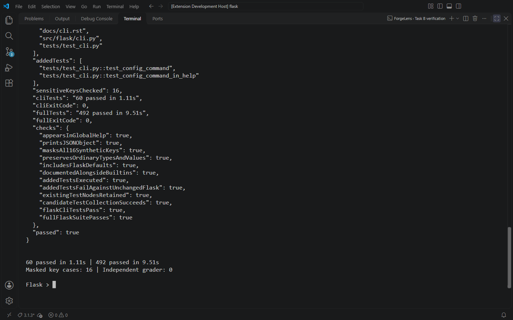

# ForgeLens in desktop VS Code

The Flask runs use the published ForgeLens v0.4.0 installer and the official Flask 3.1.3 revision, `22d924701a6ae2e4cd01e9a15bbaf3946094af65`. The two new review controls use ForgeLens v0.4.1. [Flask source](https://github.com/pallets/flask/tree/22d924701a6ae2e4cd01e9a15bbaf3946094af65) · [v0.4.0 installer verification](https://github.com/aceholland/forgelens/releases/download/v0.4.0/ForgeLens-0.4.0-package-verification.json)

The **3m 51s** recording has English narration, switchable captions and chapter markers. Waiting periods use labeled time-lapse footage. [Watch the MP4](https://github.com/aceholland/forgelens/releases/download/v0.4.1/ForgeLens-0.4.0-ABC-and-0.4.1-review.mp4) · [English captions](https://github.com/aceholland/forgelens/releases/download/v0.4.1/ForgeLens-0.4.0-ABC-and-0.4.1-review.en.srt) · [Media verification](video.json)

| Start | What to look for |
| --- | --- |
| 0:00 | Task A. Inline diff, debug flag checks, undo and the supplementary docstring review. |
| 1:05 | Task B. One request, six hunks, native session, masked JSON and passing Flask tests. |
| 2:33 | Task C. Failed connection, invalid key, automatic handoff and clean cancellation. |
| 3:04 | VS Code 1.95 and TrueForge conversation compaction. |
| 3:25 | v0.4.1 review controls. Jump to pending hunks and export the review summary. |

## Task A · Edit the selected function

In Windows VS Code 1.147.0, Nemotron 3 Ultra received the official inline instruction on the selected `get_debug_flag` function. The first diff appeared after 32 seconds. The operator accepted two hunks and saved them. The terminal printed `False` for `FLASK_DEBUG=off`. All 12 runtime checks and all 35 helper tests passed. Undo followed by Save restored all 235 tracked files. [First session and checks](task-a.json) · [First saved patch](task-a.patch)

The first docstring named `0`, `false`, `no`, `off` and `n`, and documented the default. It omitted the empty string. A supplementary inline review on a copy of the exact first patch asked the model to compare the docstring with the implementation and preserve the implementation. The model added the empty string and an unset variable to the docstring. The free provider returned HTTP 429 after the hunk was accepted. A separate local editor replay verifies that exact accepted edit. [Review request and accepted hunk](task-a-followup.json) · [Combined patch against Flask 3.1.3](task-a-final.patch) · [Independent full-suite result](task-a-full-suite.json) · [Editor attempts](task-ac-attempts.json)

The cumulative patch passed **all 490 original Flask tests** on a pristine checkout. The separate editor replay ran 35 helper tests and displayed the final docstring. Its Undo restored the exact first-pass state. [Editor replay receipt](task-a-editor-replay.json) · [Free model usage](task-a-model.json)

## Task B · One request to add a Flask command

In Windows VS Code 1.147.0, Particle‑1 received the original path-free request once through Kilo’s free endpoint. ForgeLens selected the CLI source, tests and guide. The model proposed six hunks across those three files. The operator approved the edits and staged tests. The model completed the turn in **2m 54.5s**, with zero operator hints, corrections or clarification answers. Both model responses reported **$0**. The gateway automatically retried one HTTP 429 within the same TrueForge turn. [Editor and provider receipt](task-b/editor.json) · [Native session and reconstruction of the saved edits](task-b/session.json)

The terminal showed the command in global help, masked JSON, **60 passing CLI tests** and **492 passing tests in the full Flask suite**. Applying the saved patch to another clean checkout also passed all 12 independent checks, including 16 masking cases. Both new tests failed on upstream Flask and passed with the patch applied. [Saved patch](task-b/candidate.patch) · [Editor grading](task-b/verification.json) · [Second independent replay](task-b/clean-replay.json)

Six separate free-model attempts used the same original request. Particle‑1 completed it on its first attempt. The first ERNIE attempt proposed all three files, but one of its new tests failed and the provider rate-limited further calls. The second ERNIE attempt exhausted its output budget without an edit. Three Google Gemma attempts received HTTP 503 before staging a file. Each attempt started from a clean checkout. [Kilo attempts](task-b/attempts.json) · [Google attempts](task-b-google-attempts.json) · [Reproduction instructions](../../repeat-task-b.md)

## Task C · Recover from a provider failure

In Windows VS Code 1.95.0, the operator repeated the official inline instruction. The first endpoint was unreachable, the second returned an invalid-key error, and ForgeLens handed off to a local Qwen3.5-4B model. The command palette remained responsive. After the handoff, the operator stopped the run. Git reported a clean checkout and all 235 tracked files matched their starting hashes. The receipt includes the retry sessions, models and timings. [Task C receipt](task-c.json)

## Long conversations on VS Code 1.95

A separate demonstration used a scripted loopback provider, the installed v0.4.0 extension and real TrueForge. With a synthetic conversation above the 60,000-token threshold, the first two model routes returned authorization errors. On the third route, TrueForge produced a summary and continued the turn. The review accepted two hunks and rejected one. Both staged pytest tests passed and the original files retained their hashes. [Compaction and fallback events](compaction.json)

## New review controls in v0.4.1

**Next pending hunk** opens the next undecided change at its file and line. In the Windows editor check, the command moved from line 2 to line 5 in `src/doubles.py`, wrapped back to line 2, and later moved to line 4 in the test file. The check exercised actual VS Code navigation with a scripted model. [Editor receipt](review-features.json)

**Export review summary** saves a JSON file with the numbers of accepted, rejected and pending hunks per file and the latest staged pytest exit code. It also records whether decisions changed after that test. In this example the operator accepted two hunks, rejected one, and ran two passing tests. The exported report contains relative paths and counts. [Exported example](exported-review.json)
