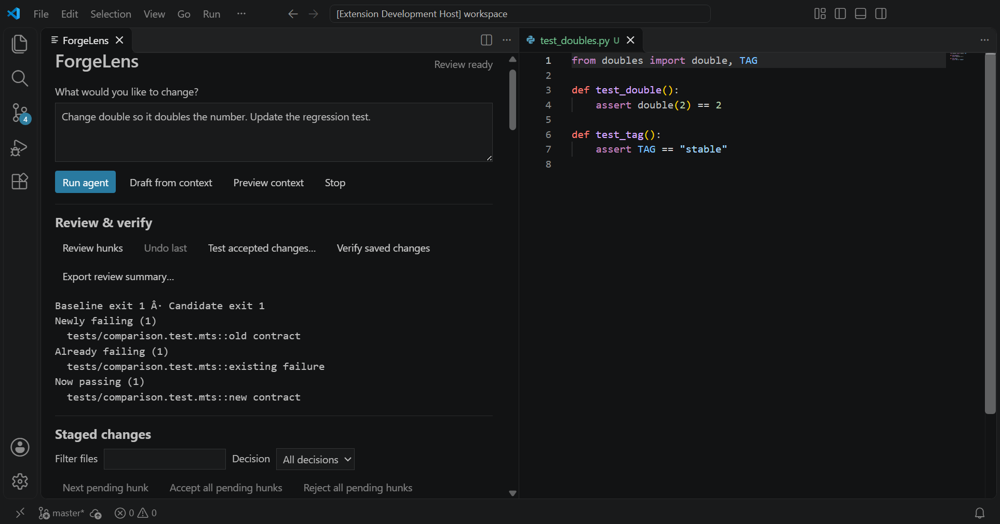
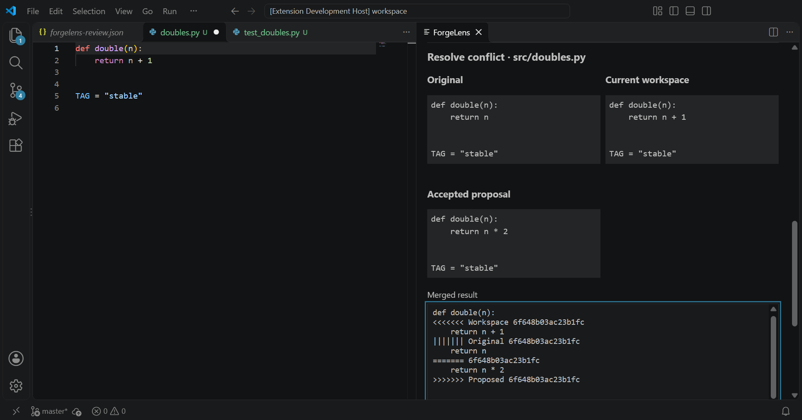

# ForgeLens 0.5.0 on desktop VS Code

The installer used on the Windows laptop had SHA-256 `70f78eb988b641a5c9ab034ea43c61889cfeb37c84bed2fe89024dff6d2e12e2`. The same bytes went through the GitHub Actions editor matrix. [Workflow run](https://github.com/aceholland/forgelens/actions/runs/45044139432) · [Installer and downloadable evidence](https://github.com/aceholland/forgelens/releases/tag/v0.5.0)

### Five features tested in the editor

| Feature | What the test observed |
| --- | --- |
| Check My Setup | The command identified a missing model, then recognized the model after it was registered. A separate probe on the laptop's normal local service returned `READY` with zero external inference requests. |
| Compare baseline and candidate | The validator ran the same Python tests on two temporary copies, recorded both exit codes, and left the originals intact. |
| Test staged JavaScript and TypeScript | A TypeScript test imported JavaScript. After the staged change, one test started failing, one still failed and one now passed. The review panel identified each by name. |
| Resume a saved review | After a full editor-host restart, the review restored two accepted hunks and one rejected hunk. It blocked restoration when an original file had changed. |
| Resolve a conflict | The reviewer edited a merge using the original, current and proposed versions. ForgeLens blocked unresolved markers and detected a second edit made while resolving. Undo restored the user's work. |

### What ran where

On the Windows laptop, the 249 source tests passed and installed copies of desktop VS Code 1.95.0 and 1.147.0 passed the setup and live-review fixtures. The desktop CI run used Linux, macOS and Windows. The live-review fixtures use a deterministic local model to make each editor action repeatable. The separate official Flask runs use actual inference. [Windows receipts, patches and official task evidence](https://github.com/aceholland/forgelens/releases/download/v0.5.0/ForgeLens-0.5.0-evidence.zip) · [Cross-platform results](https://github.com/aceholland/forgelens/releases/download/v0.5.0/ForgeLens-0.5.0-package-verification.json)

The daily Windows profile runs Qwen3.5-4B Q4_K_M through a local TrueForge service and llama.cpp on the CPU. No hosted model is configured in that profile. The test runner uses the project's available dependencies. It does not install npm packages or run package scripts.

In the recorded installer, the separator between the baseline and candidate exit codes includes an extra character. Both numerical exit codes and the per-test classifications were verified. The source on main uses a plain vertical bar.
