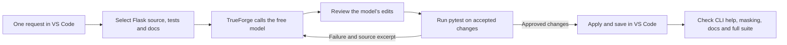

# Repeat Task B in desktop VS Code

Open a clean checkout of Flask 3.1.3 in a trusted local VS Code window with ForgeLens installed. Start local TrueForge, choose your configured model in VS Code User Settings and set **ForgeLens › Python Path** to the Python environment containing Flask's pinned test dependencies. [Extension setup](../README.md#try-it-in-vs-code) · [Flask revision and dependency versions](evidence/task-b-flash-lite/README.md#reproduce-the-independent-check)

Open **ForgeLens: Open Agent**, enter the request below once, and choose **Draft from context**. The extension selects files and source lines from the open repository. The model can propose changes, receive review decisions, run approved tests against the staged copy, and repair a failing candidate in the same turn.

> Add a new built-in CLI command flask config that prints the loaded application's configuration as JSON, masking the values of any key containing SECRET, PASSWORD, TOKEN or KEY as "***". It must appear in flask --help, be covered by a test, and be documented alongside the other built-in commands.

Review the proposed hunks and any pytest request. To reproduce the unassisted check, supply no further messages or edits. Once the turn ends, apply the accepted hunks, save and run `python -m pytest tests/test_cli.py -q` in the VS Code terminal. Inspect `python -m flask --help`, the JSON for a test app with mixed-case secret keys, and the CLI documentation.



**Run agent** can also work from a single request. Turn off **ForgeLens › Ask Questions**. Enable **Compact Requests** to provide the initial source excerpts while allowing the model to read more files as it works. Both modes retain hunk review and test approvals.

## Reproduce the recorded evaluation

The [desktop driver](../checks/task-b-desktop-launch.cjs) opens a separate editor profile and clones the pinned revision into a **new** evidence directory. It enters the official request once and clicks review controls. A clarification ends the attempt. After saving, it runs the [terminal checks](../checks/task-b-desktop-grade.py) and then applies the resulting patch to a second clean checkout for [independent grading](../checks/run-task-b-verification.py).

From a ForgeLens source checkout with Node 22, Git and a configured TrueForge server, install the locked project dependencies, run `npm run compile` and install `playwright-core@1.58.2` in a separate tools directory. In PowerShell set the following paths to your local installations.

```powershell
$env:FLASK_ROOT = 'D:\projects\flask'
$env:FORGELENS_EDITOR_EXECUTABLE = "$env:LOCALAPPDATA\Programs\Microsoft VS Code\Code.exe"
$env:FORGELENS_EDITOR_CLI = "$env:LOCALAPPDATA\Programs\Microsoft VS Code\bin\code.cmd"
$env:FORGELENS_PYTHON = 'D:\venvs\flask-tests\Scripts\python.exe'
$env:PLAYWRIGHT_CORE = 'D:\tools\node_modules\playwright-core'
$env:TRUEFORGE_URL = 'http://127.0.0.1:8790'
$env:TRUEFORGE_MODEL = 'your-provider/your-model'
$env:FORGELENS_EDITOR_MODE = 'draft'
node checks/task-b-desktop-launch.cjs D:\runs\fresh-task-b .\forgelens-0.3.1.vsix
```

The driver configures Flask’s committed public dotenv fixture in this disposable profile so that the full suite can also run before apply. Use a new output directory each time. It contains the local session receipt, saved patch, terminal results and editor captures. Inspect the result before sharing files from it. The model and provider can produce a different outcome on a repeat.
